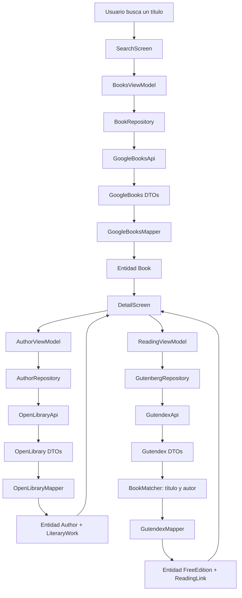

# Arquitectura — Libris (Programación 3)

La aplicación integra **tres APIs de la misma temática (libros)**. Cada API tiene las
cinco capas solicitadas: **API → Repository → DTO → Mapper → ViewModel → View**.

## Flujo concreto

1. SearchScreen pasa el texto a BooksViewModel.
2. BookRepository llama al endpoint Google Books `/books/v1/volumes`.
3. El DTO recibido se transforma a una entidad `Book` usando GoogleBooksMapper.
4. El usuario selecciona un resultado en SearchScreen.
5. LibraryApp envía esa misma entidad `Book` a la pantalla de detalles.
6. AuthorViewModel toma `book.authors.firstOrNull()` y AuthorRepository consulta
   `/search/authors.json`, `/authors/{id}.json` y `/authors/{id}/works.json` de Open Library.
7. ReadingViewModel envía el título y autores a GutenbergRepository. Busca en Gutendex
   `/books/?search=...`, cruza título + autor y transforma la coincidencia a `FreeEdition`.
8. DetailScreen muestra **en la misma pantalla** datos del libro, autor/obras y enlaces gratuitos.

### Vista de las tres capas completas

| Fuente | API | Repository | DTO | Mapper | ViewModel | View |
|---|---|---|---|---|---|---|
| Google Books | GoogleBooksApi | BookRepository | GoogleBooksResponseDto / GoogleVolumeDto | GoogleBooksMapper | BooksViewModel | SearchScreen y DetailScreen |
| Open Library | OpenLibraryApi | AuthorRepository | AuthorSearchResponseDto / AuthorDetailDto / AuthorWorksResponseDto | OpenLibraryMapper | AuthorViewModel | DetailScreen: «Conoce al autor» |
| Gutendex | GutendexApi | GutenbergRepository | GutendexResponseDto / GutendexBookDto | GutendexMapper | ReadingViewModel | DetailScreen: «Leer o descargar» |

No existe una supuesta relación directa entre IDs de Google Books, Open Library y
Gutendex: se buscan coincidencias y los enlaces solo se ofrecen si pasan un filtro
conservador. Encontrar una obra de dominio público no garantiza que sea la misma
**edición** seleccionada en Google Books.

## Responsabilidades

- `data/remote/` → definición de llamadas Retrofit (`@GET`, `@Query`, `@Path`).
- `data/dto/` → estructuras de las respuestas JSON.
- `data/mapper/` → transforma DTOs en entidades estables.
- `data/repository/` → accesos a APIs, composición y reglas de datos.
- `domain/model/` → entidades que usa la interfaz.
- `domain/matching/` → comparación de título y autor para enlaces Gutenberg.
- `ui/viewmodel/` → UI State / StateFlow, corrutinas, carga y errores.
- `ui/view/` → pantallas Jetpack Compose.
- `ui/components/` → componentes reutilizables.
- `di/` → contenedor de dependencias; evita configurar Hilt para la materia.
